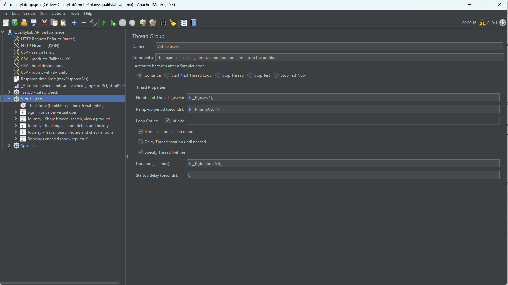
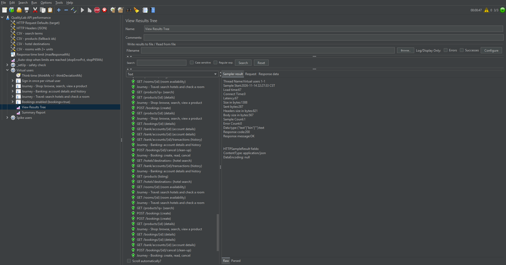

# QualityLab: performance testing with Apache JMeter

Performance tests for the QualityLab REST API (`/api/v1`) with Apache JMeter. One test plan covers five kinds of test (baseline, load, stress, spike and endurance), chosen by a profile file. Each run ends with JMeter's HTML dashboard and a Markdown table of the measured metrics.

The project is independent of the web application and of the Selenium, Playwright and Postman projects. It only calls the public REST API.

| Part | Tool |
| --- | --- |
| Load generator | Apache JMeter 5.6.3 (no plugins) |
| Test plan | `plans/qualitylab-api.jmx` |
| Test data | CSV files in `data/` |
| Runner and summary | Node.js scripts in `scripts/` |
| Reports | JMeter HTML dashboard, plus `summary.md` per run |

Measured results so far are in **[RESULTS.md](RESULTS.md)**. Every number there comes from a real run; nothing is estimated.

## Safety rules

The deployed site (`quality-lab-jb.vercel.app`) is public and runs on Vercel's free plan with a free Neon database. Both have usage limits, and Vercel's DDoS protection may throttle or block traffic that looks like an attack. So:

| Target | What may run |
| --- | --- |
| **LOCAL**: QualityLab on this PC (`localhost:3100`) | Every profile, within its own limits |
| **DEPLOYED**: `quality-lab-jb.vercel.app` | **smoke** and **baseline** only. **load** needs `--approved` (agreed beforehand) and is capped at 5 users. **stress**, **spike** and **endurance** are refused. |

The rules are enforced twice:
1. **`scripts/run.js`** refuses unsafe combinations before JMeter starts.
2. **The plan's own setUp safety check** stops the test before any virtual user starts, even when JMeter is run directly.

`--allow-high-load` lifts the limits for the deployed site. Do not use it without a written plan and the owner's agreement.

Other rules:
- Start low and increase gradually: the profiles ramp users up over time.
- Stress and spike runs stop themselves when their limits are reached.
- No money is moved under load: banking requests are read-only.
- Bookings made under load are cancelled straight away.
- Registration is not load-tested, so no users are created.

**Don't run JMeter at the same time as the Selenium, Playwright or Newman suites.** They use the same test customer.

## What the plan does

Each **virtual user**:

1. **Signs in once** to E-commerce, Banking and Travel. Each sign-in opens one module, and the tokens are reused for the rest of the run. It also reads its checking account id, and checks its session with `/auth/me`.
2. Then repeats these journeys until the profile's time is up, with **randomised think time** (Gaussian, `thinkMs ± thinkDeviationMs`) before each request:

| Journey (Transaction Controller) | Requests |
| --- | --- |
| **Shop: browse, search, view a product** | `GET /products` (listing), `GET /products?q=` (search term from CSV), `GET /products/{id}` (a random product from the search results) |
| **Banking: account details and history** | `GET /bank/accounts/{id}`, `GET /bank/accounts/{id}/transactions` |
| **Travel: search hotels and check a room** | `GET /hotels?destination=` (city from CSV), `GET /rooms/{id}?checkIn&checkOut&guests` (room from CSV, random dates 400 to 1,100 days ahead) |
| **Booking: create, read, cancel** | `POST /bookings`, `GET /bookings/{id}`, `POST /bookings/{id}/cancel`. Leave it out with `--no-bookings`. |

### How the requirements map to the plan

| Requirement | In the plan |
| --- | --- |
| Thread groups | `_setUp - safety check`, `Virtual users`, `Spike users` (idle unless the spike profile is used) |
| HTTP request defaults | `HTTP Request Defaults (target)`: protocol, host and port from the target file; 10 s connect and 30 s response timeouts |
| HTTP headers | `HTTP Headers (JSON)` for all requests, and an `Authorization: Bearer ${token_<module>}` header on each protected request |
| Authentication handling | One sign-in per module per virtual user. Credentials come from environment variables, read by the setUp check, so they never appear in files, logs or reports. |
| CSV data | Search terms, product ids, destinations, and rooms with 2 or more units (`data/*.csv`, shared by all users, recycled) |
| Correlation and dynamic variables | JSON Extractors pass values on: the module tokens, the checking account id (`$.data[?(@.type == 'CHECKING')].id`), a random product id from the search results, and the new booking's id. Stay dates are random per request (Groovy). |
| Assertions | Status code (Response Assertion), JSON values (JSON Assertion: right product, right account, booking `CONFIRMED` then `CANCELLED`, room available), and a **response time limit** on every request (`maxResponseMs`, 5 s). A slower response counts as an error. |
| Timers | Gaussian Random Timer (think time) in each thread group |
| Transaction controllers | The four journeys above |
| Response time, error rate, throughput | In the HTML dashboard and the run's `summary.md`: average, median, 90th, 95th and 99th percentile, throughput, and error % per request and per journey |

## Profiles

| Profile | Shape | Users | Duration | Where |
| --- | --- | --- | --- | --- |
| `smoke` | One user, to prove the plan works | 1 | 1 min | Local, deployed |
| `baseline` | Light, steady | 1 | 5 min | Local, deployed |
| `load` | Ramps up over 5 min, then holds | 10 (5 on deployed) | 15 min | Local; deployed with `--approved` |
| `stress` | Climbs from 0 to 50 over 20 min, holds 5 min; **stops itself** when the last 200 samples exceed 5% errors or a 3 s 95th percentile | up to 50 | up to 25 min | Local only |
| `spike` | 2 steady users; after 2 min, 28 more arrive within 5 s for 1 min | 2 → 30 → 2 | 5 min | Local only |
| `endurance` | Steady for an hour, to show drift (leaks, pool exhaustion) | 5 | 60 min | Local only |

All values are in `profiles/*.properties` and can be changed there. `--users` and `--duration` override them for one run.

## Installation

1. **Java 8 or newer.** Check with `java -version`. Java 21 (Eclipse Temurin) is already installed on this PC for the Selenium project.
2. **JMeter 5.6.3.** Download `apache-jmeter-5.6.3.zip` from https://jmeter.apache.org/download_jmeter.cgi.
   - **Check it:** compare the file's SHA-512 with the `.sha512` file published next to it. In PowerShell: `Get-FileHash apache-jmeter-5.6.3.zip -Algorithm SHA512`.
   - **Unzip it** to `C:\dev\tools\` so JMeter is at `C:\dev\tools\apache-jmeter-5.6.3`. It needs about 150 MB.
3. **Node.js 20.12 or newer**, for the runner. No `npm install` is needed: the scripts use Node's built-in modules only.

To open the plan in JMeter's GUI (for reading or editing, **not** for running load): `C:\dev\tools\apache-jmeter-5.6.3\bin\jmeter.bat`, then **File → Open** → `plans\qualitylab-api.jmx`.

## Configuration

Copy `.env.example` to `.env` and fill it in. `.env` is git-ignored.

| Variable | Meaning |
| --- | --- |
| `TEST_USERNAME`, `TEST_PASSWORD` | The seeded customer the virtual users sign in as (required) |
| `JMETER_HOME` | Where JMeter is (default `C:\dev\tools\apache-jmeter-5.6.3`) |
| `JAVA_HOME` | Optional, if `java` is not on the PATH |
| `OPEN_REPORT` | Open the dashboard in Chrome after a run: `always` (default), `on-failure` or `never` |

The targets are in `targets/local.properties` and `targets/deployed.properties`: protocol, host, port and API path.

### The LOCAL target

QualityLab must be running on this PC. In two PowerShell windows, both in `C:\dev\QualityLab\web-app`:

Window 1, the local database (leave it running):
```powershell
npm run db:start
```

Window 2, the production build of the app (leave it running):
```powershell
npm run build
npx next start -p 3100
```

Check it with `http://localhost:3100/api/v1/health`. `npm run db:reset` (local by default) puts the database back to its seed data.

Note: on LOCAL, JMeter and QualityLab share this PC's CPU and memory, so the results describe this PC, not Vercel.

## Running the tests

In the `jmeter` folder:

| Goal | Command |
| --- | --- |
| Quick check that everything works | `npm run smoke` |
| Baseline, local | `npm run baseline:local` |
| Baseline, deployed | `npm run baseline:deployed` |
| Load, local | `npm run load:local` |
| Stress, local (stops itself at the limit) | `npm run stress:local` |
| Spike, local | `npm run spike:local` |
| Endurance, local (1 hour) | `npm run endurance:local` |
| Load, deployed (only after agreeing it) | `node scripts/run.js --profile load --target deployed --approved` |
| Any profile, without bookings | `node scripts/run.js --profile load --target local --no-bookings` |
| Fewer users or a shorter run | `node scripts/run.js --profile load --target local --users 3 --duration 120` |

The same plan can also be run with JMeter directly (credentials as environment variables):

```bash
jmeter -n -t plans/qualitylab-api.jmx -q targets/local.properties -q profiles/baseline.properties -JdataDir=data -l results/run.jtl -e -o results/dashboard
```

## Reports

Every run writes a folder `results/<date-time>_<profile>_<target>/` (git-ignored):

| File | Contents |
| --- | --- |
| `dashboard/index.html` | **JMeter HTML dashboard**: statistics, over-time graphs (response times, throughput, active threads), percentiles, errors, Apdex |
| `summary.md` | The measured metrics per request and journey: samples, error %, average, median, 90th, 95th and 99th percentile, throughput |
| `results.jtl` | Raw results: one line per request |
| `jmeter.log` | JMeter's log, including the safety check and any auto-stop |
| `run-info.json` | Profile, target, users, start and end time, auto-stop reason |

`results/latest.txt` names the newest run. The dashboard opens in Chrome after the run, unless `OPEN_REPORT` says otherwise. To rebuild a summary: `npm run summarize -- results/<run folder>`.

How to read the numbers:
- **Average and median** response times, in milliseconds. The median is less affected by a few slow requests.
- **90th / 95th / 99th percentile:** 90% (95%, 99%) of requests were at least this fast.
- **Throughput:** requests per second over the run. For a request sent only once (the sign-ins), JMeter's per-request throughput is not meaningful.
- **Error %:** requests that failed an assertion, including the response time limit.
- **Journeys** add up the requests in the journey, without think time.

The setUp safety check is left out of the dashboard; its label starts with `_`.

### Screenshots (JMeter GUI)

| | |
| --- | --- |
| The **Virtual users** thread group: users, ramp-up and duration come from the profile (`${__P(users,1)}` means "the profile's value, or 1") |  |
| A 3-user practice run in the GUI with a **View Results Tree** listener: every request and journey passed its assertions |  |

Listeners like View Results Tree are for learning and debugging only. They slow JMeter down, so real load runs use non-GUI mode (see "Running the tests").

## Troubleshooting

| Problem | Fix |
| --- | --- |
| `TEST_USERNAME is not set` | Create `.env` from `.env.example`. |
| `JMeter not found` | Set `JMETER_HOME` to the folder that contains `bin\ApacheJMeter.jar`. |
| `Refused by the plan's safety check` / `not allowed against the deployed site` | Working as intended. Use `--target local`, or get approval for a light load run. |
| Every request fails on LOCAL | QualityLab is not running: start the database and `next start -p 3100` (see above). |
| `AUTO-STOP: limit reached` in a stress or spike run | That's the limit the run was looking for. See `run-info.json` and the dashboard's over-time graphs for when it happened. |
| `WARN StatusConsoleListener … package scanning` | A harmless message from JMeter's logging library. |
